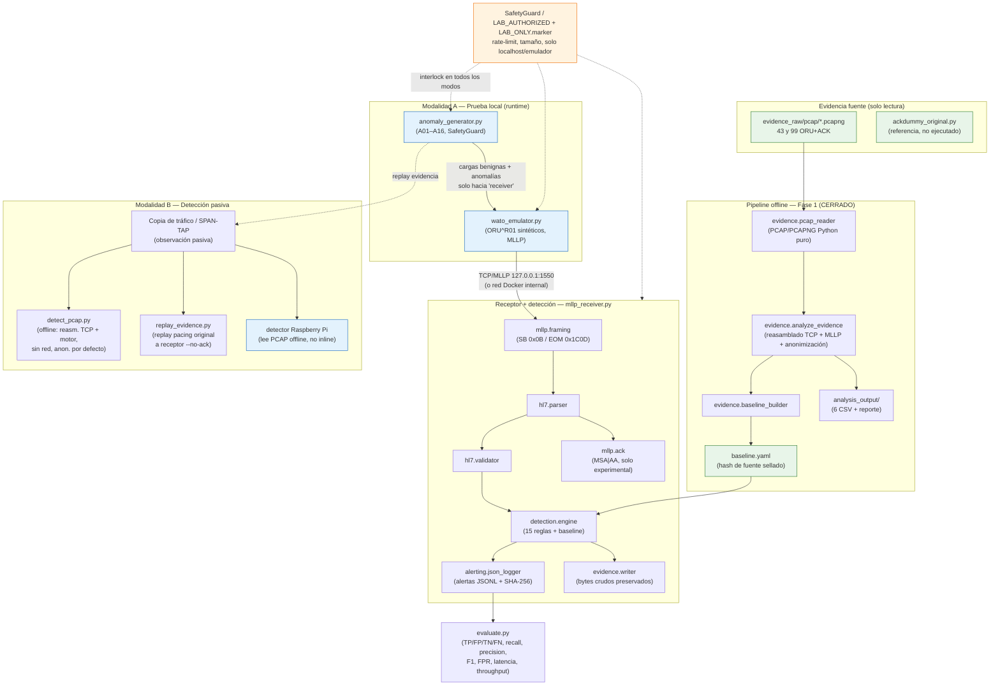

# Arquitectura del Laboratorio — Banco de Pruebas HL7/MLLP

**Proyecto:** detector determinista de anomalías para comunicaciones HL7/MLLP (Tesis G18 SIDRE)
**Fecha:** 2026-10-14 · **Estado:** Fase 9 COMPLETA (H1/H2/H3 medidos en PC; H2 en Pi pendiente);
manifest por corrida y detección offline PCAP (`detect_pcap.py`) añadidos

## 1. Visión general

El laboratorio reproduce el flujo del incidente original **sin equipo clínico real**: un emulador
sintético habla MLLP/HL7 hacia un receptor propio, un detector offline/análisis evalúa las
mensajes contra un baseline derivado de la evidencia capturada, y todo queda sellado como
evidencia. No hay componente inline en el dispositivo WATO.

```
                    ┌────────────────────────────────────────────┐
                    │  Modo runtime (Fase 2, en curso)           │
   wato_emulator ──▶│  mllp_receiver (TCP 1550)                  │
   (ORU^R01 sinté-  │   ├─ mllp.framing: SB/CR/EOM, deframing     │
   ticos, 10 s)     │   ├─ hl7.parser + hl7.validator             │
                    │   ├─ detection.engine (reglas+baseline)     │
                    │   ├─ alerting.json_logger (alertas JSONL)   │
                    │   └─ evidence.writer (captura propia)       │
                    └────────────────────────────────────────────┘

                    ┌────────────────────────────────────────────┐
   PCAP de la evid.─▶│  Modo offline (Fase 1, CERRADO)            │
   (evidence_raw/)   │   evidence.pcap_reader (PCAP/PCAPNG puro) │
                     │   evidence.analyze_evidence (mensajes,    │
                     │      sesiones, correlación ORU→ACK, anon)  │
                     │   evidence.baseline_builder → baseline.yaml│
                     │   → analysis_output/ (6 salidas selladas)  │
                     └────────────────────────────────────────────┘
```

### 1.1 Diagrama de componentes y flujo de datos (Mermaid)



Leyenda: verde = **observado** en evidencia real; azul = **sintético/simulado** (lab); naranja = **interlock de seguridad**. La equivalencia con el WATO se establece en la capa de protocolo (TCP/MLLP/HL7), no en el sistema operativo (desconocido). El detector es externo y **no inline** (no intercepta ni altera el flujo clínico).

## 2. Componentes (`src/`)

| Paquete | Archivos | Responsabilidad |
|---------|----------|-----------------|
| `mllp/` | `framing.py`, `ack.py`, `server.py` | Delimitadores MLLP (SB 0x0B, EOM 0x1C 0x0D), construcción/validación de ACK (MSA-2↔MSH-10), servidor TCP |
| `hl7/` | `parser.py`, `validator.py` | Parseo HL7 por segmentos/campos, validaciones estructurales y contra baseline (OBX, MCID, timestamp, frecuencia, FSM, identidad, framing) |
| `detection/` | `engine.py`, `rules.py`, `baseline.py` | Motor determinista con estado por sesión; 15 reglas (ID/NET/MLLP/HL7/SEQ/TIME/OBX/STATE) con severidad, límites de seguridad y mapeo MITRE; carga de `baseline.yaml` |
| `evidence/` | `pcap_reader.py`, `analyze_evidence.py`, `baseline_builder.py`, `writer.py`, `hashing.py` | Lector PCAP/PCAPNG en Python puro (sin pyshark), pipeline de análisis con anonimización por defecto, generación de baseline, escritor y SHA-256 |
| `config/` | `settings.py`, `settings.yaml` | Carga de configuración única; `laboratory.safety` (límites de §3 de ETHICS), `anomaly_generator.scenarios` (A01–A16) |
| `alerting/` | `json_logger.py` | Alertas JSONL con hash de evidencia |

Puntos de entrada en la raíz: `mllp_receiver.py` (receptor integrado), `wato_emulator.py`
(emulador sintético), `anomaly_generator.py` (inyección A01–A16 con SafetyGuard),
`run_experiment.py` (orquestador; escribe `manifest.json` por corrida),
`run_matrix.py`/`run_campaign.ps1` (campañas múltiples), `replay_evidence.py` (replay H3),
`detect_pcap.py` (detección offline sobre PCAP, Modalidad B),
`latency_bench.py` (H2) y `evaluate.py` (métricas).

## 3. Datos y directorios

| Ruta | Contenido | Protección |
|------|-----------|------------|
| `evidence_raw/pcap/` | 5 capturas originales (2 con HL7: 43 y 99 ORU+ACK) | solo lectura + SHA-256 en `evidence_inventory.csv` |
| `analysis_output/` | 6 salidas del pipeline de evidencia | regenerables; selladas por hash en el commit |
| `baseline.yaml` | Baseline STANDBY (hash de fuente `41761f0a9d8b…`) | versionado; regenerable con `--build` |
| `config/rules.yaml`, `src/config/settings.yaml` | Reglas y escenarios (técnicas ATT&CK v20) | versionado |
| `analysis_output/*.jsonl` (runtime) | Alertas del receptor | por sesión, no sellados hasta cierre de lab |

## 4. Interfaz y dependencias

- **Red:** solo `127.0.0.1`/`::1` o Docker internal; puerto **1550/tcp** (MLLP). El emulador usa
  hostname fijo `mllp-receiver` (Docker) o `localhost`; `mllp_receiver.py` acepta `--host`
  (por seguridad del lab debe usarse `127.0.0.1` cuando no hay red Docker).
- **Software:** Python 3.11.9 (`.venv`); dependencias runtime: **PyYAML** (obligatoria) y
  **psutil** (opcional: muestreo de CPU/RAM del receptor en `manifest.json`; sin ella el
  manifiesto registra una nota) — `requirements.txt`; dev: `pytest`.
- **Puerto por defecto del receptor `0.0.0.0`** es un hallazgo abierto: restringir a localhost
  en despliegues sin Docker (pendiente en backlog).

## 5. Interlock de seguridad (presente en todos los modos)

1. `LAB_AUTHORIZED=YES` (entorno) + `LAB_ONLY.marker` exigidos por settings.
2. Límites `safety` (≤70 anomalías por corrida, ≤5 msg/s, ≤32 KiB, cooldown ≥30 s,
   `safety_limit` por escenario) — ver `ETHICS_AND_SAFETY.md` §3.
3. Anonimización por defecto en todo artefacto derivado de evidencia clínica.
4. Evidencia original inmutable (solo lectura) + SHA-256 verificable.

## 6. Estado de despliegue

| Ítem | Estado |
|------|--------|
| Python + Git + venv | ✅ instalados (Fase 0) |
| Suite de pruebas | ✅ 188 passed (2026-10-14, incl. manifest + detect_pcap) |
| Pipeline evidencia (offline) | ✅ cerrado y commiteado (Fase 1) |
| Emulador + receptor + generador + evaluador | ✅ funcionales (Fase 2/4); E2E local y docker OK |
| Orquestador `run_experiment.py` | ✅ modo local y docker probados; `manifest.json` por corrida (protocolo §6) |
| Detección offline PCAP | ✅ `detect_pcap.py` (Modalidad B) con tests sintéticos |
| Campaña H1 + H3 + bench H2 (PC) | ✅ 2026-10-14 (`RESULTS_20261014.md`) |
| Docker Desktop/WSL (host Windows) | ✅ Docker 29.8.2 + WSL2; compose validado y E2E OK (evidencia en named volume `lab_output`) |
| Ejecución en Raspberry Pi | ⬜ pendiente (`RASPBERRY_PI_SETUP.md`, Fase 6) |

## 7. Convenciones

- Comandos con `workdir` en la raíz; `.venv\Scripts\python.exe -m pytest` para la suite.
- `src/` no tiene `__init__.py` en paquetes heredados: los imports son relativos dentro de
  `src.*` y absolutos desde `mllp_receiver.py`.
- Ediciones compartidas: verificar `LastWriteTime` antes de tocar `src/mllp`, `src/hl7`,
  `src/detection` (sesión paralela activa) y commitear solo archivos propios.
- Técnicas MITRE: solo IDs verificados contra ATT&CK ICS v20 (`THREAT_MODEL.md` §4, §7).
